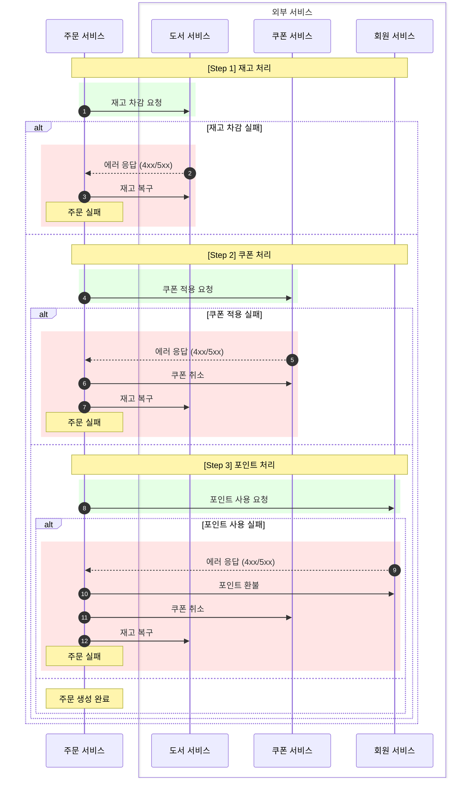

# MSA에서의 분산 트랜잭션과 사가 패턴 적용기

## 1. 배경 - MSA와 분산 트랜잭션

온라인 서점 프로젝트의 요구사항 중 하나는 MSA였다. MSA는 하나의 애플리케이션을 독립적인 여러 개의 서비스로 나누어 개발하는 아키텍처이다. 요구사항에 따라 팀원들과 서비스를 어떻게 분리할지 논의를 거친 끝에 도서, 회원, 쿠폰, 검색, 주문/장바구니/결제로 서버를 분리하기로 했다. 다만 주어진 DB 서버는 하나여서 모든 서비스가 하나의 DB를 사용하되, 논리적으로 분리하는 구조를 선택하기로 했다.

이렇게 서비스를 분리하게 되면서 트랜잭션의 범위도 서비스 단위로 나눠지게 되었다. 하나의 DB를 공유하더라도, 트랜잭션은 각 서비스가 관리하는 커넥션 단위로 실행되기 때문이다. 하지만 당시에는 이 사실을 이해하지 못하고 주문 생성 방식 구현을 단순히 `@Transactional` 어노테이션만 사용하면 쉽게 처리할 수 있다고 생각했다. 아래 코드는 처음 만들었던 주문 생성 로직의 요약 코드이다.

```java
@Transactional
public OrderResponse createOrder(Long memberId, OrderCreateRequest request) {
    // 1. 주문 상품 ID 리스트 추출
    // 2. 주문 상품 수량 맵 추출
    // 3. 도서 API에 재고 감소 요청 전송
    bookClient.decreaseStock(orderQuantityMap);
    // 4. 도서 API에서 도서 정보 리스트 받아오기
    // 5. 도서 정보 리스트로 도서 정보 맵 생성
    // 6. DTO를 엔티티(OrderItem)로 매핑
    // 7. 할인 전 결제 금액 계산 (도서 + 포장비)
    // TODO: 쿠폰 적용
    // 8. 배송비 결정
    // 9. 회원 API에서 포인트 사용 처리
    memberClient.usePoint(pointUsage);
    // 10. Order 객체 생성
    // Order 저장 후 응답 반환
}
```
이렇게 구현된 주문 생성 로직은 문제가 없어 보였다. 하지만 주문 생성 로직을 테스트하는 과정에서 주문 생성이 9번 포인트 사용 처리 중 예외가 발생해 실패했는데 3번에서 차감된 도서 재고가 복구되지 않는 문제가 발생했다. 사용자의 주문 생성 요청이 포인트 부족으로 실패했지만, 주문 수량만큼의 재고가 사라져버렸던 것이다.

한 팀원이 사가 패턴이라는 것을 사용해야 한다고 해서 그제서야 관련 내용을 찾아보기 시작했다. 기존의 모놀리식 아키텍처에서는 하나의 커넥션으로 도서 재고 차감, 쿠폰 사용, 포인트 사용이 모두 이루어져 도중에 실패하면 모든 변경 사항을 즉시 롤백할 수 있었다. 하지만 MSA 환경의 우리 서비스에서는 주문 관련 변경 사항만 처리할 뿐, 도서 재고 차감이나 포인트 사용같은 변경은 해당 서비스의 커넥션으로 처리되기 때문에 도중에 실패하더라도 이미 각각의 서비스에서 커밋이 되었기 때문에 자동으로 되돌릴 수가 없었던 것이다.

이러한 분산 트랜잭션을 처리하는 방식으로 2PC(Two-Phase Commit)과 사가(Saga) 패턴이 자주 비교되었는데, 2PC는 강한 일관성을 제공하지만 참여 서비스 중 하나만 일시적으로 장애가 발생해도 전체 트랜잭션이 블로킹되고, 모든 서비스가 커밋을 마칠 때까지 락을 쥐고 있어 동시성과 처리량이 떨어지고, 네트워크 지연이나 장애가 잦은 MSA에 적합하지 않은 패턴이라고 한다. 그래서 MSA에 적합하다는 사가 패턴을 사용하기로 결정했다.

---

## 2. 오케스트레이션 사가

사가(Saga) 패턴은 분산 환경에서 여러 서비스에 걸친 트랜잭션을 작은 로컬 트랜잭션으로 나누고, 실패 시 보상(Compensating) 트랜잭션으로 이전에 성공한 내용을 되돌리는 요청을 보내 데이터 일관성을 유지하는 디자인 패턴이다. 데이터베이스가 제공하는 자동 롤백이 아닌, 개발자가 애플리케이션 레벨에서 직접 구현한 보상 로직을 실행해 상태를 되돌리는 것이다.

사가 패턴을 구현하는 방식은 두 가지로 나뉜다. 오케스트레이션(Orchestration) 방식은 하나의 서비스가 전체 트랜잭션의 순서와 보상 트랜잭션을 지휘하는 방식이다. 다른 방식은 코레오그래피(Choreography) 방식인데, 각 서비스가 이벤트를 발행하고 구독해 자율적으로 처리하는 방식이다. 

두 가지 방식을 확인하고 난 뒤 오케스트레이션 방식을 사용하기로 했다. 코레오그래피 방식은 서비스 간 결합도가 낮다는 장점이 있지만, 흐름을 직관적으로 파악하기 어렵다. 분산 트랜잭션을 처음 다뤄보는 만큼 구현이 쉽고 직관적인 방식을 선택했다.

주문 서비스에서 도서 서비스에서 도서 재고 차감을, 쿠폰 서비스에서 쿠폰 사용을, 회원 서비스에서 포인트 사용을 지시하고, 하나라도 실패하면 주문 서비스가 보상 트랜잭션을 직접 호출하는 것이다. 

통신 방식은 비동기 메시지 큐 대신 `OpenFeign` 기반 동기 호출을 선택했다. '비동기', '메시지 큐' 모두 좋은 의미지만 8주라는 프로젝트 일정에서 새로운 인프라를 학습하고 도입하고 운영하기 어려울 것이라고 생각했기 때문이다. 그래서 더 쉬운 방법으로 기능을 완성하는 것을 목표로 잡았다.

---

## 3. 주문 생성과 주문 취소

구현하다 보니 주문 생성과 주문 취소를 같은 전략으로 복구할 수 없다는 것을 알게 되었다.

주문 생성은 (`1. 도서 재고 차감` -> `2. 쿠폰 사용` -> `3. 포인트 사용`) 세 가지 중 하나라도 실패하면 성공한 모든 요청을 되돌려야 한다. 결국 주문이 생성되지 못했기 때문이다.

주문 취소는 다르다. 처음에는 주문 취소도 실패하면 주문 생성과 똑같이 롤백하면 되지 않나 싶었는데 생각해보니 그럴 수 없었다. 

첫 번째는 고객의 취소 의사였다. 취소 의사를 가지고 보낸 주문 취소 요청은 반드시 성공해야 한다. 그래서 주문 생성처럼 롤백을 하면 '고객의 주문 취소 요청을 취소하고 다시 주문을 생성'하는 말도 안되는 사용자 경험이 된다.

두 번째는 롤백이 불가능한 상태이다. 주문 취소는 (`1. 환불` -> `2. 포인트 복구` -> `3. 쿠폰 반환` -> `4. 도서 재고 증가`) 흐름을 가진다. 만약 쿠폰 반환 중 실패하면 반환된 포인트를 다시 차감하고, 환불된 금액을 다시 지불하게 할 것인가? 물론 그렇게 할 수 있을지도 모른다. 그런데 만약 반환된 포인트를 다시 차감하기 전에 고객이 사용해버렸다면 어떻게 해야 할까? 어떻게 할 수도 없는 상황이 되어버린다.

그래서 실패를 처리하는 방법을 다르게 가져가기로 했다. 주문 생성이 실패하면 보상 트랜잭션을 보내고, 주문 취소가 실패하면 성공할 때까지 재시도하는 전략을 사용하기로 결정했다.

---

## 4. 주문 생성 프로세스 



(4xx 에러 응답에는 에러가 발생한 서비스에는 보상 요청을 보내지 않아도 되지만, 보내게 설정한 이유는 5번 항목에서 다룸)

### 주문 생성 상태
| 단계 | 상태                 | 설명             |
|:---|:-------------------|:---------------|
| 1  | `STARTED`          | 사가 인스턴스 생성     |
| 2  | `STOCK_DECREASING` | 재고 차감 요청 송신 중  |
| 3  | `STOCK_DECREASED`  | 재고 차감 완료       |
| 4  | `COUPON_APPLYING`  | 쿠폰 적용 요청 송신 중  |
| 5  | `COUPON_APPLIED`   | 쿠폰 적용 완료       |
| 6  | `POINT_USING`      | 포인트 사용 요청 송신 중 |
| 7  | `POINT_USED`       | 포인트 사용 완료      |

처음에는 완료 상태(`..ED`)만 기록했다. 그런데 테스트하던 도중 주문 서비스를 강제 종료했을 때 도서 재고는 차감되었지만 주문 생성 사가의 상태는 `STARTED`에 멈춰 있는 경우가 생겼다. 재고 차감 요청을 보내고 `STOCK_DECREASED`로 상태를 변경하기 전에 서버가 종료되었던 것이다. 이런 경우에는 재고 차감 요청을 보냈는지 알 방법이 없어 나중에 이 멈춘 주문을 복구할 때 도서 재고를 복구해야 할 지 결정할 수 없었다. 그래서 `STOCK_DECREASING` 처럼 진행 중을 표시하는 상태를 외부 API 호출 직전에 먼저 저장하기로 했다.

---

## 5. 5xx는 실패인가? 

구현이 어느 정도 완성됐던 시점에 한 팀원이 테스트 프로젝트를 만들어 작업이 완료된 뒤 예외를 의도적으로 터뜨리는 테스트를 보여줬다. 작업은 성공했지만, 응답으로는 500, Internal Server Error가 반환되었다. 여기서 5xx 케이스를 처음 인식했다. 

```java
public void test() {
    // 재고를 차감하는 트랜잭션 메서드
    bookService.decreaseStock(...);
    
    throw new RuntimeException();
}
```

외부 서비스가 이 `test()`라는 API를 호출하면 어떻게 될까? 500 에러 응답을 받을 것이다. 위 코드에서는 단순히 예외를 던지는 것으로 표현했지만, 이는 네트워크 지연이나 단절처럼 다른 이유일 수도 있다. 또 트랜잭션 메서드가 호출된 뒤일 수도 있고, 호출 전일 수도 있다.

그렇다면 만약 주문 서비스가 도서 서비스에 도서 재고 차감 요청을 보냈는데 5xx번대 에러나 타임아웃이 발생하면 어떻게 해석해야 할까? 도서 재고가 차감되었다는 의미일까 아니면 도서 재고가 차감되지 않았다는 의미일까?

4xx번대 에러는 의미가 명확하다. 재고가 부족하거나 아니면 다른 이유로 요청 자체가 거부된 것이므로 도서 서비스에는 보상하지 않아도 된다. 도서 재고가 차감되지 않았기 때문에 주문 서비스는 4xx 응답을 받고 주문을 실패 처리만 하면 된다.

5xx번대 에러는 의미가 명확하지 않다. 어쩌면 도서 재고가 차감되었을 수도 있고, 차감되지 않았을 수도 있다. 그러면 주문 서비스는 5xx 응답을 받고 보상 요청을 보내야 할까? 보낸다면 차감하지 않은 도서 재고를 늘릴 수 있다. 보내지 않는다면 차감된 도서 재고를 복구하지 못할 수도 있다.

5xx 에러 응답을 받았을 때도 보상 요청을 보내야 한다. 도서 재고가 차감됐을 확률이 0%가 아니기 때문이다. 그런데 4xx 응답에는 해당 에러 응답을 반환한 서비스에는 보상 요청을 보내지 않아도 되는 것이 아닌가?

처음에는 보상 요청을 보내는 실패와 보내지 않는 실패를 구분하려 했다. 하지만 에러가 발생할 수 있는 경우의 수는 너무 많다. 4xx, 5xx, 연결 거부, 타임아웃 등 이렇게 수많은 경우를 어떻게 분류할 것인가? 모든 케이스를 완벽하게 분류할 수 있을까? 그래서 확실하게 그냥 모든 실패에 대해 보상 요청을 보내기로 결정했다. 하지만 역시 예상했던 문제가 드러났다. 위에서 언급한 차감하지도 않은 도서 재고를 늘리는 문제이다. 

### 6. 멱등성

```java
public abstract class OrderSaga extends BaseTimeEntity {
    @Id
    private UUID sagaId;               // 멱등성 식별을 위한 고유 트랜잭션 키

    private Long orderId;              // 보상 트랜잭션 적용 대상 주문 ID

    private SagaStatus overallStatus;  // 사가 전체 상태 (PROGRESS, COMPLETED, FAILED, COMPENSATED, COMPLETED_COMPENSATED)

    private boolean bridged = false;   // 주문 도메인 엔티티와 최종 동기화 완료 여부
}

public class OrderCreateSaga extends OrderSaga {
    private CreateSagaStep lastCompletedStep; // 마지막으로 성공한 체크포인트 단계
}
```

주문 생성, 취소, 환불 등 분산 트랜잭션을 처리하는 하나의 흐름을 기록하기 위해 사가 엔티티로 정의해 데이터베이스에 저장했다. (ex) `OrderCreateSaga`) `sagaId`는 도서, 회원 서비스에서 멱등성을 지키기 위해 사용된다.

```java
// 도서 서비스

@Transactional
public void decreaseStock(UUID sagaId, Map<Long, Integer> quantityMap) {
    OrderBookSagaLogId sagaLogId = new OrderBookSagaLogId(sagaId, OrderSagaType.DECREASE_STOCK);

    if (orderBookSagaLogRepository.existsById(sagaLogId)) {
        return; // 이미 처리된 요청
    }

    orderBookRepository.decreaseStock(quantityMap);
    orderBookSagaLogRepository.save(new OrderBookSagaLog(sagaLogId));
}

@Transactional
public void rollbackStock(UUID sagaId, Map<Long, Integer> quantityMap) {
    OrderBookSagaLogId sagaLogId = new OrderBookSagaLogId(sagaId, OrderSagaType.ROLLBACK_STOCK);

    if (orderBookSagaLogRepository.existsById(sagaLogId)) {
        return; // 이미 롤백 완료
    }

    // 실제로 해당 요청으로 재고가 차감되었는지 확인
    boolean hasDecreased = orderBookSagaLogRepository.existsById(
        new OrderBookSagaLogId(sagaId, OrderSagaType.DECREASE_STOCK)
    );
    if (!hasDecreased) {
        return;
    }

    orderBookRepository.increaseStock(quantityMap);
    orderBookSagaLogRepository.save(new OrderBookSagaLog(sagaLogId));
}
```

멱등성만으로는 '차감되지 않은 도서 재고를 복구하는 요청'을 막을 수 없다. 그래서 `rollbackStock`에서는 재고를 복구하기 전에 사가 ID와 차감 이력(`DECREASE_STOCK`)을 기준으로 실제로 해당 요청으로 재고가 차감되었는지 확인한다.

쿠폰 서비스에서는 `is_used` 상태가 이진값이라 `UPDATE` 쿼리 자체가 이미 멱등하다.

```sql
UPDATE coupons SET is_used = true WHERE coupon_id = ? AND is_used = false
```

이미 사용된 쿠폰에 동일 요청이 오면 영향 행이 0이 되어 자연스럽게 중복 처리가 방지된다.

---

## 7. 결론

분산 환경에서 도서 - 회원 - 쿠폰 서비스에 걸친 주문 흐름을 처리하다 보니 MSA 아키텍처에 대해 다시 생각해보게 되었다. 팀 프로젝트의 요구사항이기도 했지만, 현대적인 아키텍처로 알려져 있는 MSA를 경험해본다는 것에 들떠서 나도 서비스를 도메인 기준으로 분리하는 데 동의했다. 하지만 그 결과는 엄청난 난이도와 복잡도의 분산 트랜잭션이었다.

사실 모놀리식 아키텍처였다면 내가 첫 번째로 구성했던 주문 생성 로직을 그대로 사용하면 실패해도 DB의 자동 롤백에서 끝났을 것이다. 하지만 분산 환경에서는 그럴 수 없었고, 결국 보상 트랜잭션이라는 것을 필요로 했다.

사실 내가 작성한 로직도 올바른 로직인지 모르겠다. 그래도 이번 프로젝트의 가장 큰 수확은 네트워크의 불확실성과 멱등성에 대해 배운 것이다. 서비스의 경계에 대해서도 다시 생각해보게 되었다. MSA를 경험해보지 않았다면 전혀 생각해 볼 수 없었을 것이다.
